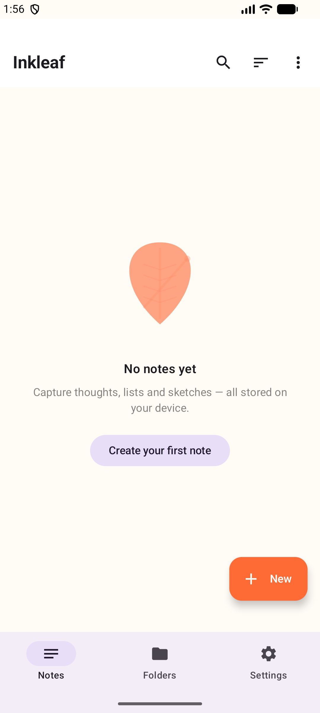
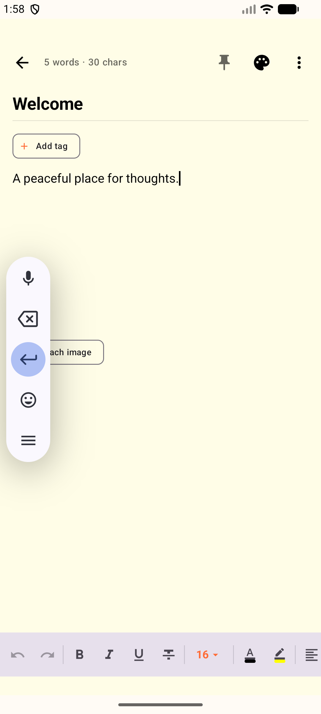
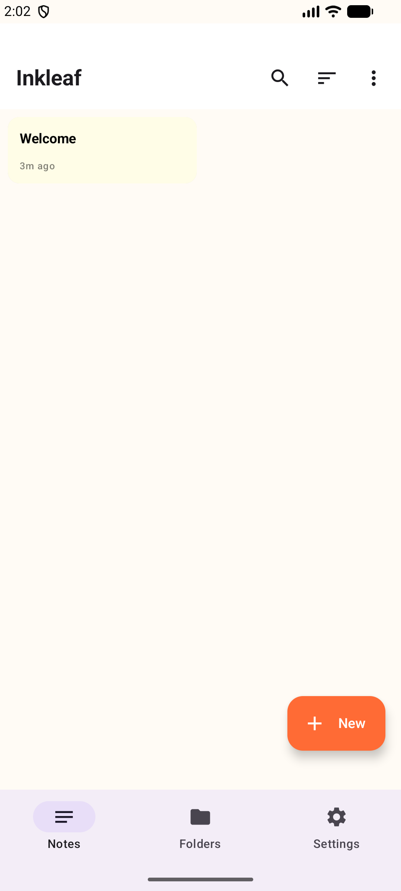

# Inkleaf

> An offline-first Android notes app: quick capture, folders, a distraction-free editor and settings — no account, no cloud.

<p align="center">
  
  
  
</p>

## Built with

Kotlin · Android · Gradle

## Run locally

```bash
./gradlew assembleDebug
# install app/build/outputs/apk/debug/app-debug.apk on a device or emulator
```
